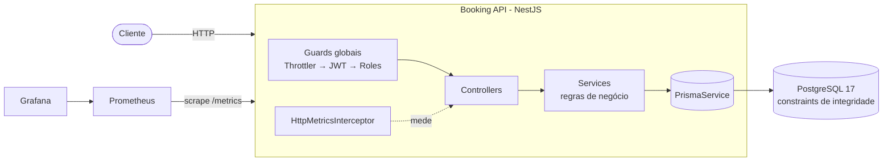
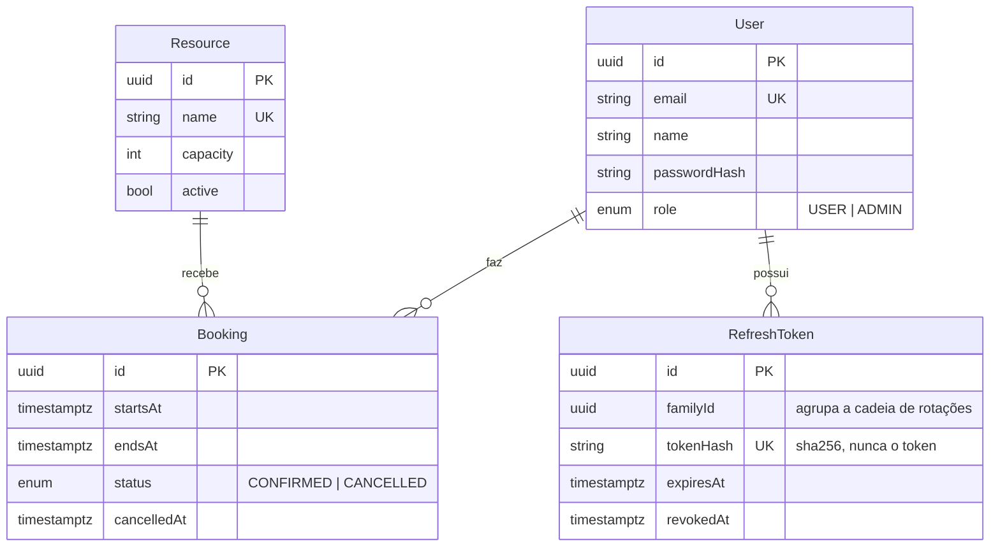
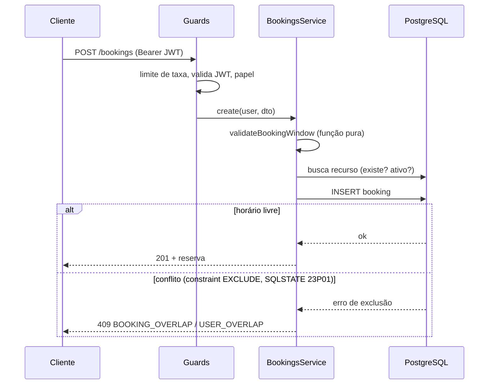

# Arquitetura

## Visão geral

Monólito modular em NestJS. Cada módulo de domínio tem controller (HTTP e documentação), service (regras)
e DTOs (contrato e validação de entrada). O acesso ao banco é feito pelo Prisma, injetado como provider.



## Estrutura

```
src/
  main.ts, app.setup.ts     bootstrap e configuração compartilhada com os testes e2e
  app.module.ts             composição dos módulos e dos guards globais
  config/env.ts             variáveis de ambiente validadas com Zod
  auth/                     cadastro, login, refresh com rotação, guards JWT e de papéis
  resources/                recursos reserváveis + cálculo de disponibilidade (availability.ts, função pura)
  bookings/                 reservas + regras (booking-rules.ts, funções puras)
  health/                   liveness e readiness (Terminus)
  metrics/                  registro Prometheus, interceptor HTTP e endpoint /metrics
  prisma/                   PrismaService e tradução de erros do driver
  common/                   decorators, paginação, filtro de exceções
prisma/
  schema.prisma             modelo de dados
  migrations/               SQL versionado (inclui as constraints que o Prisma não expressa)
test/                       testes e2e (Postgres real) e helpers
ops/                        Prometheus e Grafana (dashboard provisionado)
```

Regras de negócio ficam em **funções puras** (`booking-rules.ts`, `availability.ts`): recebem dados e `now`
por parâmetro, não tocam no banco e por isso são testadas de forma exaustiva e rápida.

## Modelo de dados



Identificadores são UUID v7 (ordenáveis por tempo, bons para índices). Datas usam `timestamptz`.
Constraints no banco, além das chaves: `endsAt > startsAt` e dois `EXCLUDE` (recurso e usuário) sobre o
intervalo `[startsAt, endsAt)` das reservas `CONFIRMED`. Veja a [ADR 0001](adr/0001-conflitos-de-reserva-no-banco.md).

## Fluxo: criar uma reserva



Não existe "consultar se está livre e depois inserir": isso abriria uma janela de corrida entre as duas etapas.
O `INSERT` é a verificação.

## Segurança

| Ameaça                              | Mitigação                                                                      |
| ----------------------------------- | ------------------------------------------------------------------------------ |
| Força bruta de senha                | Limitador `auth` (padrão 10 req/min/IP) + bcrypt                               |
| Enumeração de contas                | Login responde igual para e-mail inexistente e senha errada; compara hash sempre |
| Roubo de refresh token              | Uso único, rotação, detecção de reuso revoga a família; só o hash fica no banco  |
| Escalonamento de privilégio         | Papel nunca vem do cliente; `forbidNonWhitelisted` recusa campos extras         |
| Acesso a dados de outros usuários   | Escopo por usuário no service; 404 (não 403) para não revelar existência         |
| Vazamento em logs                   | `Authorization`, cookies e senhas mascarados; erros 500 não expõem detalhes     |
| Cabeçalhos HTTP inseguros           | `helmet`                                                                       |
| Configuração insegura               | Segredo JWT mínimo de 32 caracteres exigido na subida                           |

## Pipeline

`CI` (GitHub Actions): formatação → lint → tipos → migrations → testes com cobertura mínima → build → imagem
Docker e **teste de fumaça da stack completa** (sobe o Compose, roda o seed, faz login e consulta a API) →
publicação da imagem no GHCR (apenas em `main`/tags e só se tudo passou). Dependabot atualiza npm, Actions e Docker.
